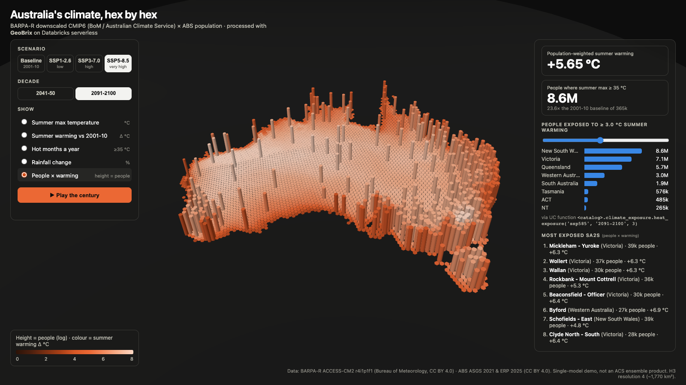
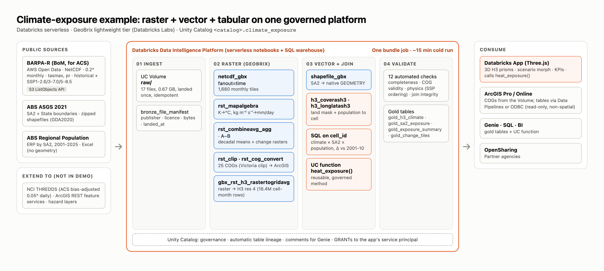

# Climate exposure with GeoBrix: BARPA-R projections × ABS population

An end-to-end, serverless example that turns **downscaled CMIP6 climate projections** (NetCDF rasters) into a
**population-exposure analysis**, and serves it in a **3D Databricks App**. Raster, vector and plain tabular data are
joined on one governed platform:

- **Raster:** BARPA-R monthly projections (Bureau of Meteorology, for the Australian Climate Service), read with
  [GeoBrix](https://github.com/databrickslabs/geobrix)'s lightweight tier
- **Vector:** ABS ASGS 2021 SA2 and state boundaries → native `GEOMETRY` + H3
- **Tabular:** ABS Estimated Resident Population, a plain Excel sheet with no geometry
- **Output:** gold tables, Cloud-Optimised GeoTIFFs for desktop GIS, a reusable Unity Catalog SQL function, and a
  Three.js app

Everything is deployed with one **Databricks Asset Bundle** (one serverless job plus one app).





---

## What it shows

| Theme | How it's done here |
|---|---|
| Accessing large open datasets and APIs | Discovers files via the public S3 ListObjects API (AWS Open Data), lands them once in a UC Volume, and records a provenance manifest |
| Multidimensional raster | `netcdf_gbx` with `fanout=time` turns 14 NetCDF files (variable × scenario × decade) into 1,680 monthly raster tiles in one DataFrame |
| Normalisation | `rst_mapalgebra` converts K → °C and kg m⁻² s⁻¹ → mm/day; `rst_combineavg_agg` builds decadal means; change rasters are computed against a 2001-2010 baseline |
| Raster ↔ vector | `rst_clip` with an ABS state boundary as the cutline; `gbx_rst_h3_rastertogridavg` puts every tile on an H3 grid |
| Joining geo and non-geo data | H3 cell is the common key: raster cells, SA2 polygons (`h3_coverash3`, `h3_longlatash3`) and the population spreadsheet (SA2 code) |
| Hand-off to desktop GIS | 25 Cloud-Optimised GeoTIFFs (DEFLATE) written to the Volume, ready for ArcGIS or QGIS |
| Reusable methods | `heat_exposure(scenario, period, min_warming)`, a SQL table function in Unity Catalog, called by the app |
| Quality gate | `04_validate` runs 12 checks (completeness, valid COGs, physical plausibility, join integrity) |
| Lineage | Every step writes Unity Catalog tables by name, so table and column lineage is captured automatically |

## Data

| Dataset | Publisher | Used | Licence |
|---|---|---|---|
| [BARPA-R, CORDEX-CMIP6 AUS-20i](https://registry.opendata.aws/australian-bureau-of-meteorology-barpa/) (`s3://bom-opendata-climate`) | Bureau of Meteorology, for the Australian Climate Service | ACCESS-CM2 r4i1p1f1, BARPA-R1-NN v1-r1, monthly `tasmax` and `pr`, 0.2° grid; historical 2001-2010 + SSP1-2.6 / SSP3-7.0 / SSP5-8.5 for 2041-2050 and 2091-2100 (14 files) | CC BY 4.0 |
| [ASGS Edition 3 (2021)](https://www.abs.gov.au/statistics/standards/australian-statistical-geography-standard-asgs/edition-3-july-2021-june-2026/access-and-downloads/digital-boundary-files) SA2 + state boundaries | Australian Bureau of Statistics | Shapefiles, GDA2020 | CC BY 4.0 |
| [Regional population 2024-25](https://www.abs.gov.au/statistics/people/population/regional-population/2024-25) (Table 1) | Australian Bureau of Statistics | Estimated Resident Population by SA2, 2021 and 2025 | CC BY 4.0 |

About 0.67 GB is downloaded in total (17 files).

> **Read the numbers as a demonstration of the method.** This is a single driving model and member (ACCESS-CM2 sits at
> the warmer end of CMIP6), at monthly resolution. Official products use multi-model ensembles and bias adjustment.

---

## Prerequisites

- A Databricks workspace with **Unity Catalog**, **serverless notebooks and jobs**, serverless **environment version 6**, and **Databricks Apps**
- An existing **catalog** where you have `USE CATALOG` and `CREATE SCHEMA`
- A **SQL warehouse** (serverless recommended); you need `CAN_USE`
- **Outbound internet from serverless compute** to `bom-opendata-climate.s3.ap-southeast-2.amazonaws.com`, `www.abs.gov.au` and `github.com` (the GeoBrix wheel is installed from its GitHub release)
- [Databricks CLI](https://docs.databricks.com/dev-tools/cli/install.html) with bundle and Apps support (tested with v1.19), authenticated to the workspace

## Deploy and run

```bash
cd raster/climate-exposure-geobrix

export BUNDLE_VAR_catalog=<your_catalog>            # existing catalog
export BUNDLE_VAR_warehouse_id=<sql_warehouse_id>   # e.g. from: databricks warehouses list
# optional: BUNDLE_VAR_schema (default climate_exposure), BUNDLE_VAR_app_name (default climate-exposure-explorer)

databricks bundle validate
databricks bundle deploy                            # uploads notebooks + app, creates the job and app
databricks bundle run climate_exposure_pipeline     # builds the data, about 15 min on serverless
databricks bundle run climate_exposure_app          # starts the app and prints its URL
```

Run the pipeline **before** opening the app: its last task grants the app's service principal read access to the schema.

## What gets built

The job `climate-exposure-pipeline` runs five notebook tasks in order:

| Task | Notebook | Builds |
|---|---|---|
| `ingest_open_data` | `01_ingest_open_data` | Schema, Volume, downloaded files, `bronze_file_manifest` |
| `raster_geobrix` | `02_raster_geobrix` | `silver_climate_monthly_tiles` (1,680 tiles), `silver_climate_decadal_tiles`, `gold_change_tiles`, 25 COGs in `<volume>/outputs/cog/`, `silver_h3_monthly` (~16.4M rows) |
| `vector_join_exposure` | `03_vector_join_exposure` | `silver_sa2_boundaries`, `silver_sa2_population`, `silver_h3_land`, `silver_sa2_cell`, `gold_h3_climate`, `gold_sa2_exposure`, `gold_exposure_summary`, `gold_state_outlines`, function `heat_exposure()` |
| `validate` | `04_validate` | 12 checks; exits with a JSON verdict |
| `grant_app_access` | `05_grant_app_access` | `USE CATALOG` + `USE SCHEMA, SELECT, EXECUTE` for the app's service principal |

`00_config` holds the shared settings (catalog, schema, volume, scenarios, decades, H3 resolution, heat threshold) and is
`%run` by every notebook. Every notebook is re-runnable.

Try the reusable function in the SQL editor:

```sql
SELECT * FROM <catalog>.climate_exposure.heat_exposure('ssp370', '2091-2100', 3.0) ORDER BY population DESC;
```

## The app

A FastAPI backend serves a Three.js front end. The backend reads the gold tables through the Statement Execution API,
as the app's service principal.

| Aspect | Detail |
|---|---|
| Map | One `InstancedMesh` of hexagonal prisms, one per H3 land cell (~4,900). Height and colour both encode the selected measure |
| Measures | Summer max temperature, summer warming vs 2001-10, hot months a year, rainfall change, people × warming (height = population, colour = warming) |
| Interaction | Scenario and decade switches morph the prisms; "Play the century"; hover tooltip per hexagon; state outlines |
| Side panel | KPI tiles from `gold_exposure_summary`; state bars from the `heat_exposure()` UC function (slider = minimum warming); top SA2s |
| Libraries | Three.js r170 (vendored, no CDN or build step), FastAPI, databricks-sdk, h3-py |

## Customise

- **Other decades, scenarios or variables:** edit `FUTURES`, `BASELINE` and `VARIABLES` in `00_config` (any variable published under the same BARPA path pattern).
- **Grid resolution:** `H3_RES` (default 4, ~1,770 km², about 4 BARPA pixels per cell).
- **Heat threshold:** `HOT_MONTH_C` (default 35 °C).

## Clean up

```bash
databricks bundle destroy                           # removes the job and the app
```

Then drop the data: `DROP SCHEMA <catalog>.climate_exposure CASCADE;`

## Troubleshooting

| Symptom | Fix |
|---|---|
| `ModuleNotFoundError: rasterio`, or the kernel fails to start | The notebook isn't on serverless environment 6. The `.ipynb` files pin it in their metadata; if you copied the code elsewhere, set the environment version to 6 in the notebook's Environment panel |
| `No such struct field window` from an `rst_*` function | `netcdf_gbx` emits a legacy tile struct. Keep the `rst_fromcontent(...)` line in `02` |
| `INVALID_PANDAS_UDF_PLACEMENT` | `rst_combineavg_agg` is a pandas grouped aggregate and must be alone in its `.agg()` |
| COGs won't open in macOS Preview | Expected: they hold single-band float values. Open them in QGIS or ArcGIS |
| The app shows "Failed to load data" | Run the pipeline first (it creates the tables and grants access), and check that the SQL warehouse is running |
| Download errors in `01` | Serverless needs outbound access to the hosts listed under Prerequisites |

## Notes

- **GeoBrix is a Databricks Labs project** (provided as-is, no SLA). Native Databricks `GEOMETRY`, ST and H3 functions used here are GA.
- Lineage to the source files in the Volume is only recorded for native Spark reads (for example `read_files`). The GeoBrix and pandas readers used here don't report it, so the lineage graph starts at the first table.
- GDA2020 and WGS 84 differ by under 2 m, so the boundaries are treated as lon/lat for H3.

## Attribution

BARPA-R data: Bureau of Meteorology, CC BY 4.0. ASGS boundaries and Regional Population: Australian Bureau of Statistics, CC BY 4.0.
